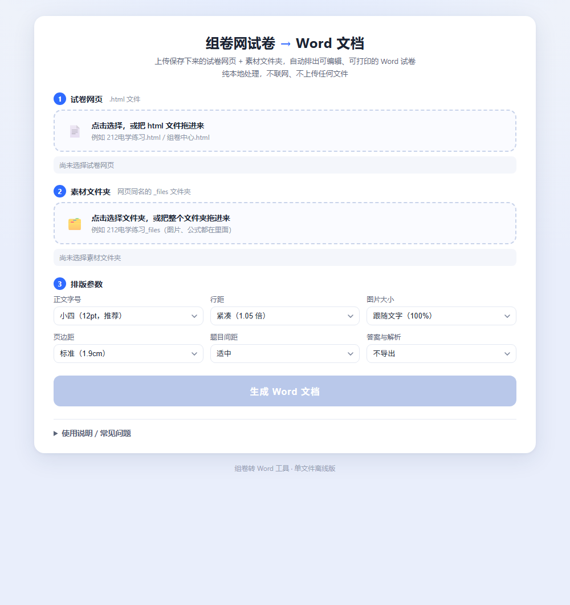

# 组卷转 Word 工具

把**学科网组卷中心**保存下来的试卷网页（`xxx.html` + `xxx_files`），在浏览器里转换成**结构化、可编辑、可直接打印**的 Word 文档（.docx）。

纯前端单文件，双击即用，不联网、不上传任何文件。



## 为什么需要它

学科网页"直接打印成 PDF"有两个通病：

- 每道题有固定高度，题与题之间留出大片空白，打印很费纸；
- 图片是绝对定位的，题目一多就错位。

自己用脚本抽文字又会丢掉选项表格、填空横线、上下标，图片全被堆到末尾，排出来很乱。

本工具是**逐题解析网页 DOM**，把题干、选项、填空、上下标、数据表格重排成 Word 原生内容，只有电路图/实物图这类真图片才按原尺寸内嵌。

## 功能

- 题型标题用黑体、正文用宋体，字号/行距/边距/题间距可调；
- 选项表按网页的 1/2/4 列自动排成单列段落或 2/4 栏无框表格，图片选项把 `A．B．C．D．` 居中放在图上方；
- 填空横线、`上标/下标`、`<i>` 斜体、加粗强调、数据表格（带框线）原样重排；
- 网页里的公式小图（如 `A₁`、`L₂`、`U_AB`、`0.5m²`）是矢量图形，工具用浏览器把它们渲染成 6 倍高清 PNG，按与正文同比例、同基线内嵌，打印不发虚；
- 图与所在题干"不跨页拆开"，不会出现文字在上一页、图在下一页；
- 页脚自动生成"第 X 页 / 共 Y 页"；
- 可选导出【答案】【解析】（默认关闭）；
- 缺图会在预览里列出清单，不会静默丢图。

## 使用方法

1. 打开 `dist/index.html`（双击，或访问 GitHub Pages）。
2. 第 1 步选择试卷网页 `xxx.html`，第 2 步选择同名的 `xxx_files` 文件夹（也可以把文件夹整个拖进页面）。
3. 选好参数 → 点「生成 Word 文档」，浏览器会下载 `试卷标题.docx`。

> 网页怎么来：打开组卷结果的「试卷预览」页面，按 `Ctrl + S` → 保存类型选「网页，仅 HTML」，会得到一个 `xxx.html` 和一个 `xxx_files` 文件夹，两者要一起保留。

### 参数

| 参数 | 可选值 | 默认 | 说明 |
| --- | --- | --- | --- |
| 正文字号 | 小四 / 四号 / 五号 / 小三 | 小四（12pt） | 标题按字号自动加粗放大 |
| 行距 | 紧凑 / 单倍 / 1.15 / 1.5 | 紧凑（1.05） | 影响页数最明显的参数 |
| 图片大小 | 80% / 100% / 120% | 100% | 图片与文字的相对比例 |
| 页边距 | 1.6 / 1.9 / 2.2 cm | 1.9 cm | A4 纵向 |
| 题目间距 | 紧凑 / 适中 / 宽松 | 适中（6pt） | 每题前留白 |
| 答案与解析 | 不导出 / 导出 | 不导出 | 网页里有才会生效 |

示例：一份 22 题的物理练习（56 处插图），小四 + 紧凑行距排出 **8 页**，四号约 9~10 页。

## 工作原理

```
试卷 HTML ──DOMParser──► 题目模型（段落/选项表/数据表/图片）
                                   │
        xxx_files 图片 ──canvas──►  PNG/JPEG（SVG 公式 6× 栅格化，超大位图降采样）
                                   │
                      ──►  OOXML（WordprocessingML）  ──►  ZIP（自带实现）  ──►  .docx
```

- 解析：`src/core.js` —— 识别 `.paper-body / .ques-type / .tk-quest-item / .exam-item__cnt`，把 DOM 转成块模型；保留 `sub/sup/i/b/bk(填空)/table[name=optionsTable]` 等语义。
- 生成：`src/docx.js` —— 直接拼 WordprocessingML，图片按 EMU 换算尺寸，表格用 `tblLayout=fixed` 保证列宽稳定。
- 打包：内置 ZIP 写入器（CRC32 + `CompressionStream('deflate-raw')`，不可用时退回存储模式），因此**零依赖**，不需要 JSZip。
- 界面：`src/ui.js` + `src/index.tpl.html`，文件/文件夹选择、拖拽、预览、导出。

## 目录结构

```
.
├── src/
│   ├── core.js          HTML 解析 → 题目模型
│   ├── docx.js          OOXML 生成 + ZIP 打包 + 图片处理
│   ├── ui.js            界面交互
│   └── index.tpl.html   界面模板与样式（<!--SCRIPTS--> 为注入点）
├── build_tool.py        构建脚本：把 src/ 拼成单文件 HTML
├── dist/                构建产物（已提交，供直接下载 / GitHub Pages）
│   ├── index.html
│   └── 组卷转Word工具.html
└── .github/workflows/build-deploy.yml
```

## 本地构建

需要 Python 3.8+，不需要第三方库：

```bash
python build_tool.py            # 生成 dist/index.html 与 dist/组卷转Word工具.html
python build_tool.py out.html   # 或输出到指定文件
```

产物是单个自包含 HTML（约 67 KB），里面没有任何外链脚本、样式或 CDN 依赖。

## 部署

**个人使用**：把 `dist/index.html` 拷到任意位置，双击即可。

**内网共享**：丢进 nginx / IIS 的静态目录，同事访问 `http://内网IP/xxx.html` 即可。服务器不需要 Node、Python 或后端接口，试卷文件只在该用户的浏览器内存里处理，不会上传。

**GitHub Pages**：push 到 `main` 后，Actions 会自动构建并部署到 Pages，访问仓库对应的 Pages 地址即可使用。

## 常见问题

**Q：图片为什么不是截图？**
A：工具逐题解析 DOM，文字和表格是 Word 原生对象，只有真图片才嵌入。

**Q：公式能不能变成可编辑的公式对象？**
A：不能。网页里的 `A₁`、`U_AB` 是矢量路径图形，没有 LaTeX 源码，转成文字只能靠公式 OCR，错一处就要手改，不划算，因此按同基线高清小图内嵌。

**Q：提示"缺 N 个图片文件"？**
A：说明素材文件夹没选全，缺的图会留空，其余内容照常生成。

**Q：支持别的网站吗？**
A：目前按组卷网的 DOM 结构适配；其它站点若有 `.paper-body + .tk-quest-item` 类似结构也能识别，否则会提示"没有识别到题目"。

**Q：浏览器要求？**
A：Chrome / Edge 90 以上（103+ 会启用压缩，docx 更小）。不支持 IE。

## 声明

本项目仅用于教师个人把已购买的试卷资源转成便于打印的 Word 版式。试卷内容版权归原站点与命题方所有，请勿用于传播或商业用途。
